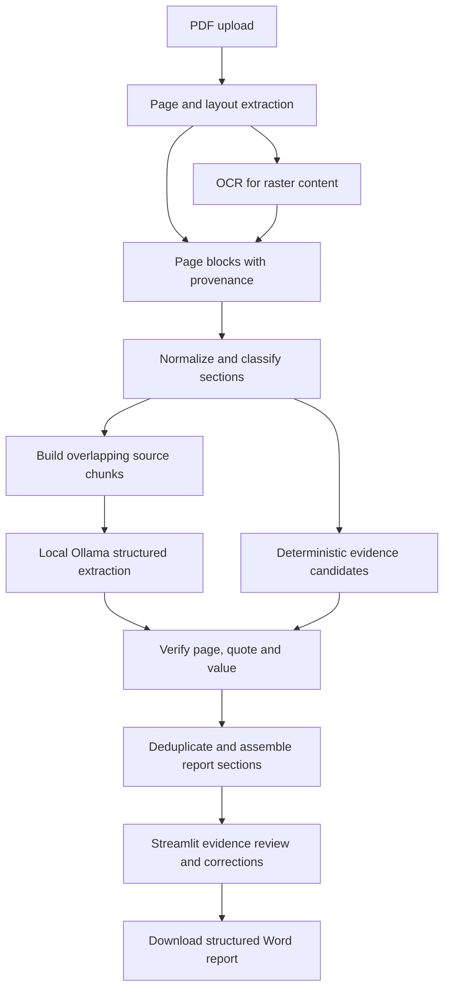

# DocuMind AI — PDF Analysis & Summarization Agent

Project PDFs often spread objectives, deliverables, technical requirements and deadlines across prose, scanned pages and tables. DocuMind AI turns those sources into an editable, six-section Word report. Its objectives are to retain distinct project facts, preserve their source pages, and distinguish a stated deadline from a date or a duration.

## Architecture



PyMuPDF extracts embedded text, layout clues and detected tables. Pillow and Tesseract recover raster text. Deterministic section rules preserve the source context while a local Qwen model extracts structured facts in chunks. Pydantic validates response shape, and page-local quote checks require an extractive value. Near matches are flagged and excluded. The analyst assembles concise source clauses, combines duplicate facts, and derives schedule fields from labeled columns or explicit language. OCR warnings identify the affected page. Model chunk warnings identify the affected pages. Reports can still use facts verified against the current PDF. python-dateutil helps recognize dates while keeping the original wording. Streamlit provides review and python-docx generates the download in memory.

## Windows setup

Use PowerShell from the project root. Python 3.12 is the supported runtime. For a fresh checkout without a virtual environment, create it with `py -3.12 -m venv .venv`. For the assessment workspace, reuse the existing environment.

```powershell
.\.venv\Scripts\python.exe --version
.\.venv\Scripts\python.exe -m pip install -r requirements.txt
```

Install Ollama for Windows if it is absent. Start the Ollama desktop app or run `ollama serve` in a separate terminal. Use `ollama list` to check for the model. Download it once if needed.

```powershell
ollama pull qwen3:1.7b
Invoke-RestMethod http://localhost:11434/api/tags
```

Install Tesseract for Windows with the English language data if it is absent. The app searches PATH and `C:\Program Files\Tesseract-OCR\tesseract.exe`. See the [Tesseract installation guide](https://tesseract-ocr.github.io/tessdoc/Installation.html).

```powershell
& 'C:\Program Files\Tesseract-OCR\tesseract.exe' --list-langs
# For a custom installation
$env:TESSERACT_CMD = 'D:\Tools\Tesseract-OCR\tesseract.exe'
```

The app reads PowerShell environment variables set before launch. See `.env.example` for names and defaults. `OLLAMA_BASE_URL` accepts a loopback origin, `OLLAMA_MODEL` sets the model, and `OLLAMA_TIMEOUT` sets the read timeout in seconds. Model selection and OCR mode are also available in the sidebar. The app uses the [Ollama chat API](https://docs.ollama.com/api/chat) with a JSON schema and local inference.

## Run and review

```powershell
.\.venv\Scripts\python.exe -m streamlit run app.py
```

Open [the local app](http://localhost:8501). Upload `samples/sample_project.pdf`, choose **Auto**, and select **Start Analysis**. Inspect the detected headings, exact quotations, page numbers and warnings. Edit the title, section text or schedule in **Summary & report**. Select **Generate Word report**, then **Download Word Report**. Export uses the reviewed fields in session state. Manual corrections are user supplied.

The Word report has a centered 16-point bold Calibri project name, 14-point bold headings, 11-point body text, and six ordered sections. Its four-column implementation timeline uses a repeating header when rows exist. Missing sections use the source-document notice, and missing individual schedule cells use “Not specified”.

## Test

```powershell
.\.venv\Scripts\python.exe -m pytest -q
.\.venv\Scripts\python.exe -m compileall app.py src tests
.\.venv\Scripts\python.exe -m samples.generate_samples --scanned
.\.venv\Scripts\python.exe -m samples.run_sample
.\.venv\Scripts\python.exe -m samples.run_sample samples/sample_project_scanned.pdf
.\.venv\Scripts\python.exe -m samples.run_sample samples/sample_project_mixed.pdf
```

The generator creates a three-page municipal flood-monitoring brief, an image-only copy, and a mixed copy with page 2 rasterized. Upload each PDF using **Auto**. The evidence tab reports OCR by page. Expected OCR pages are none for the text sample, all three for the scanned sample, and page 2 for the mixed sample. The fixture-based pytest suite uses mocked OCR and inference. The live sample commands use real Tesseract and Ollama and write reports under `output/`. A run with an OCR failure can save a report with page warnings and exit with code 2. A run with a model chunk warning can also save its current-PDF report and exit with code 2.

## Troubleshooting

| Symptom | Action |
|---|---|
| Ollama unreachable | Start the desktop app or run `ollama serve`, then check the API tags endpoint. |
| Model missing | Run `ollama pull qwen3:1.7b`, then refresh the app. |
| Ollama timeout | Set `$env:OLLAMA_TIMEOUT = '240'` before starting the app and retry. |
| OCR unavailable or missing language pack | Check `TESSERACT_CMD`, then run Tesseract with `--list-langs` and install the selected language data. |
| Blank, scanned or badly encoded page | Inspect extracted text and try Force OCR if embedded text is incomplete. |
| PDF rejected | Check that it opens locally without a password and is within 50 MiB and 300 pages. |
| Missing or ambiguous field | Inspect source evidence and correct the report before export. |

## Known limitations and future improvements

Heading and date recognition are tuned for English. Tesseract language packs can recover other scripts, but downstream rules may miss their labels and deadlines. Layout reconstruction is best effort for multi-column pages, borderless tables and scanned schedules. Unrecognized schedule content can appear in the report as source prose. Local model quality and latency vary with hardware and document complexity. Quote matching establishes textual support, while the final review remains important for context and OCR errors.

Potential extensions include stronger scanned-table reconstruction, multilingual classifiers, page-image highlighting and evaluation against a manually labeled document set.

